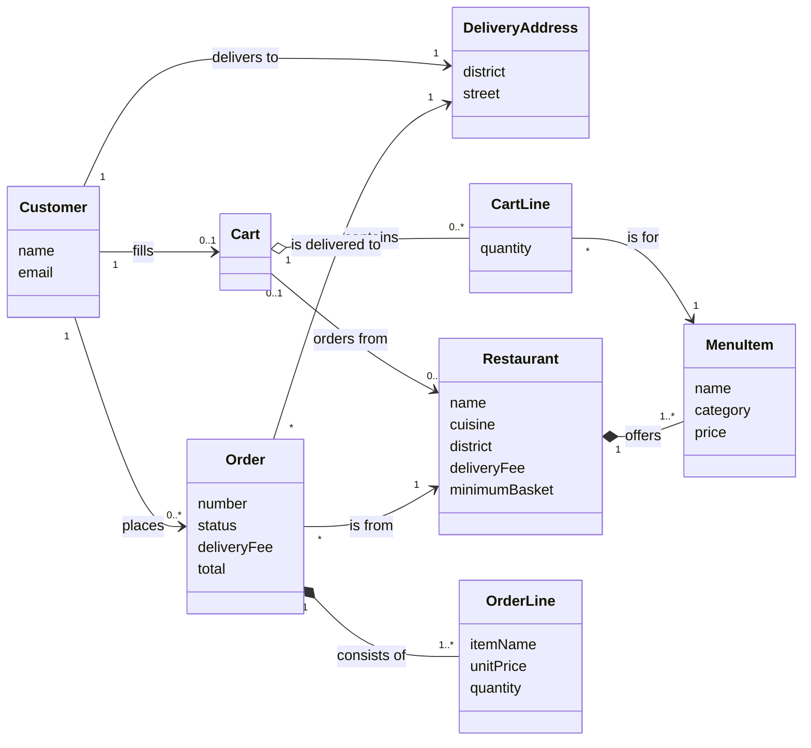

# Domain Model (D5)

Conceptual model: concepts, attributes and associations with multiplicities. No methods, no Java types, no UI or file classes.

## Notes
- **Cart ↔ Restaurant (BR-2):** a cart refers to at most one restaurant; empty cart: none.
- **CartLine → MenuItem (BR-3):** per cart, each menu item appears on at most one line.
- **OrderLine is not a link to MenuItem (BR-7):** it records name and price at the time of ordering, so later menu changes do not change a placed order (see `design-decisions.md`).
- `total` of an Order is derived: sum of line totals + `deliveryFee` (BR-5).
- `status` starts as PLACED (BR-6); `number` is unique and increasing (BR-6).
- Customer is identified by `email` (BR-8).
- All words follow `glossary.md`.

