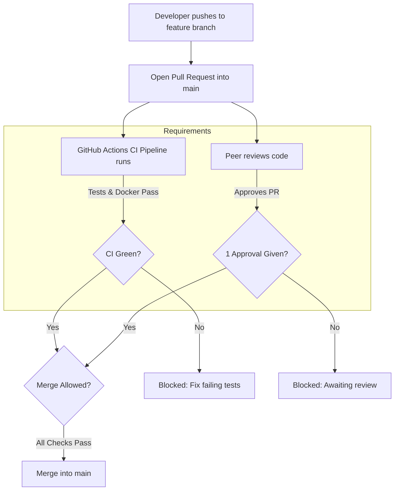

# GitHub Branch Protection & Pull Request Review Guide

This guide provides step-by-step instructions for configuring GitHub branch protection rules on your repository. Once configured, **no code can be pushed directly to `main`**. Instead, every change must go through a **Pull Request (PR)**, pass the **GitHub Actions CI pipeline**, and receive **at least 1 peer approval** before merging.

---

## 1. Overview of the Protection Policy



---

## 2. Prerequisites

1. Your repository must be hosted on **GitHub** (public or private).
2. The `.github/workflows/ci.yml` file must exist on the `main` branch.
3. The GitHub Actions CI pipeline must run **at least once** so GitHub recognizes the check name (`Build, Test & Verify`).
   *(Pushing the `.github` directory to GitHub will automatically trigger this initial run).*

---

## 3. Step-by-Step Configuration on GitHub

### Step 1: Navigate to Branch Settings
1. Open your repository page on GitHub.
2. In the top navigation bar, click on **Settings** (gear icon).
3. In the left sidebar, under the **Code and automation** section, click on **Branches**.

---

### Step 2: Add a Protection Rule for `main`
1. Next to **Branch protection rules**, click the **Add branch protection rule** (or **Add rule**) button.
2. Under **Branch name pattern**, enter:
   ```text
   main
   ```

---

### Step 3: Require Pull Request Reviews
1. Check the box: **Require a pull request before merging**.
2. Check the box: **Require approvals**.
3. Set **Required number of approvals before merging** to:
   ```text
   1
   ```
4. *(Recommended)* Check **Dismiss stale pull request approvals when new commits are pushed** (if a teammate approves your PR and you push more changes afterwards, the approval resets so they can re-verify the new code).

---

### Step 4: Require CI Status Checks to Pass
1. Check the box: **Require status checks to pass before merging**.
2. Check the box: **Require branches to be up to date before merging** (ensures your branch is tested against the latest version of `main`).
3. Under the **Status checks that are required** search box:
   * Type: `Build, Test & Verify`
   * Select the check from the list when it appears.
   *(Note: If you don't see this check yet, trigger the CI once by pushing a commit, then refresh this page).*

---

### Step 5: Enforce Restrictions for All Contributors
1. *(Recommended for school projects)* Check **Do not allow bypassing the above settings**.
   * This applies the rule to repository owners and administrators as well, ensuring everyone follows the peer-review process.
2. Click **Create** (or **Save changes**) at the bottom of the page.
3. If prompted by GitHub, confirm with your GitHub password or two-factor authentication.

---

## 4. How the Team Uses This Workflow

### Step 1: Open a Feature Branch
```bash
git checkout main
git pull origin main
git checkout -b feature/cart-and-pricing-rules
```

### Step 2: Commit & Push Changes
```bash
git add .
git commit -m "feat(cart): enforce single restaurant constraint"
git push -u origin feature/cart-and-pricing-rules
```

### Step 3: Open a Pull Request
1. Go to your GitHub repository.
2. Click the yellow banner: **Compare & pull request**.
3. Set the base branch to `main` and compare branch to your feature branch.
4. Fill in the title and description summarizing your changes.
5. In the right sidebar under **Reviewers**, select one of your team members.
6. Click **Create pull request**.

### Step 4: What Happens Next?
* GitHub Actions will immediately run the **FoodFlow CI Pipeline**.
* The **Merge pull request** button will be **disabled (greyed out)** with messages indicating:
  * `Review required: At least 1 approving review is required`
  * `Required statuses must pass: Build, Test & Verify`

### Step 5: How the Teammate Reviews & Approves
1. The assigned reviewer visits the PR link.
2. Clicks the **Files changed** tab to inspect code diffs.
3. Clicks the green **Review changes** button at the top right.
4. Selects **Approve** and adds an optional comment (e.g., *"Looks good, tests pass!"*).
5. Clicks **Submit review**.

### Step 6: Merging
Once the green checkmark appears for `Build, Test & Verify` and `1 approval` is recorded:
1. The green **Merge pull request** (or **Squash and merge**) button becomes active.
2. Click the button and confirm the merge.
3. You can safely delete the feature branch on GitHub.
4. Locally, switch back to `main` and pull the latest changes:
   ```bash
   git checkout main
   git pull origin main
   ```

