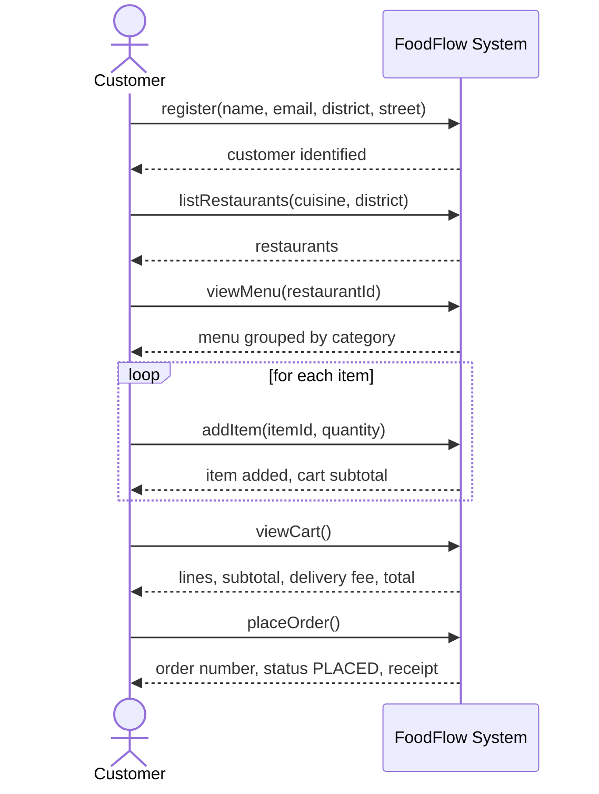

# SSD and Operation Contracts (D6)

## System Sequence Diagram – Place Order, main success scenario

The system operations map to the public methods of `OrderingService`: `register`, `login`, `listRestaurants`, `viewMenu`, `addItem`, `changeQuantity`, `removeItem`, `clearCart`, `viewCart`, `placeOrder`, `myOrders`.

---

## Contract CO1: `addItem(itemId, quantity)`
- **Cross references:** Use cases Manage Cart, Place Order
- **Preconditions:**
  - A menu item with id `itemId` exists in the loaded restaurants.
  - `quantity` is between 1 and 20 (BR-1).
  - The cart is empty, or it belongs to the restaurant of that item (BR-2).
  - If the item is already in the cart: existing quantity + `quantity` ≤ 20.
- **Postconditions:**
  - If the cart had no line for the item: a new `CartLine` was created, associated with the `MenuItem`, with quantity = `quantity`, and added to the `Cart`.
  - Otherwise: the quantity of the existing `CartLine` was increased by `quantity`; no new line was created (BR-3).
  - If the cart was empty: the `Cart` became associated with the item's `Restaurant` (BR-2).
  - The cart subtotal changed by price × `quantity`.
  - If a precondition fails, nothing changed (cart, lines and restaurant association are as before).

## Contract CO2: `placeOrder()`
- **Cross references:** Use case Place Order
- **Preconditions:**
  - A `Customer` is identified and has a delivery address (BR-4).
  - The `Cart` is not empty (BR-4).
- **Postconditions:**
  - An `Order` instance was created.
  - The order's `number` is the next unique, higher number than all earlier orders; its `status` became PLACED (BR-6).
  - The order was associated with the `Customer`, with the restaurant of the cart and with the customer's delivery address.
  - One `OrderLine` was created for each `CartLine`, with the item's name, unit price and quantity copied at that moment (BR-7).
  - The order's `deliveryFee` was set to the restaurant's delivery fee; `total` = sum of line totals + `deliveryFee` (BR-5).
  - All `CartLine`s were removed from the `Cart` and the cart's association with the restaurant was removed; the cart is empty (BR-7).
  - The order was added to the customer's orders of this session.
  - If a precondition fails: no order was created, no number was used, the cart is unchanged.

