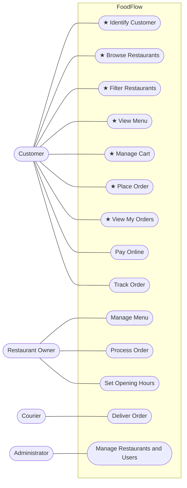

# Use-Case Model (D3)

## Use-case diagram – whole product
I1 use cases are marked with ★.

## Brief use cases (I1)
| # | Use case | Actor | Brief description |
|---|---|---|---|
| UC1 | Identify Customer | Customer | The customer registers with name, e-mail and delivery address (BR-8), or continues as an existing customer by e-mail. |
| UC2 | Browse Restaurants | Customer | The customer sees all restaurants with cuisine, district and delivery fee. |
| UC3 | Filter Restaurants | Customer | The customer narrows the list by cuisine and/or district; an empty result is reported politely. |
| UC4 | View Menu | Customer | The customer sees a restaurant's items grouped by category with prices. |
| UC5 | Manage Cart | Customer | The customer adds items, changes quantities, removes items and views the cart with totals (fully dressed below). |
| UC6 | Place Order | Customer | The customer orders the cart's content, paying cash on delivery (fully dressed below). |
| UC7 | View My Orders | Customer | The customer lists the orders placed in this session. |

---

## Fully dressed: Manage Cart (UC5)
- **Scope:** FoodFlow console application
- **Level:** user goal
- **Primary actor:** Customer
- **Stakeholders and interests:** Customer wants the cart to show correct prices and totals. Restaurant wants orders to concern its own menu only.
- **Preconditions:** The restaurant list has been loaded. (No customer identification is needed to fill a cart.)
- **Postconditions (success):** The cart reflects the customer's wishes: one line per item, valid quantities, items from one restaurant.
- **Trigger:** The customer wants to collect items to order.

### Main success scenario
1. The customer chooses a menu item and a quantity.
2. The system checks quantity (BR-1) and restaurant (BR-2) and adds the item to the cart.
3. The system shows the new cart subtotal.
4. The customer repeats 1–3 for further items.
5. The customer asks to see the cart.
6. The system shows each line with unit price, quantity and line total, then subtotal, delivery fee and total (BR-5).
7. The customer changes a quantity of a line. The system validates it (BR-1) and shows the updated subtotal.
8. The customer removes an item. The system removes the line and shows the updated subtotal.

### Extensions
- **2a. The item is unknown:** The system reports the unknown item; the cart is unchanged.
- **2b. The quantity is not a number:** The system asks for a whole number (BR-9). The cart is unchanged.
- **2c. The quantity is below 1 or above 20 (BR-1):** The system refuses with the allowed range. The cart is unchanged.
- **2d. The item belongs to a different restaurant than the cart's items (BR-2):** The system refuses, naming the restaurant already in the cart. The customer may empty the cart (7a) and continue, or keep the old cart.
- **2e. The item is already in the cart (BR-3):** The system increases the quantity of the existing line; no second line is created.
  - **2e1. The summed quantity exceeds 20 (BR-1):** The system refuses; the line keeps its old quantity.
- **7a. The customer empties the cart:** The system removes all lines; the cart no longer belongs to any restaurant.
- **7b. The item to change/remove is not in the cart:** The system reports it; the cart is unchanged.
- **\*a. Invalid input at any time (BR-9):** The system shows a clear message and the customer can try again; the program continues.

### Special requirements
All amounts are shown with two decimals and "TL" (BR-5).

---

## Fully dressed: Place Order (UC6)
- **Scope:** FoodFlow console application
- **Level:** user goal
- **Primary actor:** Customer
- **Stakeholders and interests:** Customer wants a correct total and a confirmation. Restaurant wants a complete, unambiguous order. Course staff / future iterations want an order that never changes after being placed.
- **Preconditions:** The customer is identified (UC1). The cart is not empty (BR-4).
- **Postconditions (success):** An order exists with a unique, increasing number and status PLACED; it records the lines (name, price, quantity), delivery fee, total and the customer's delivery address; the cart is empty; the order appears in the customer's order list.
- **Trigger:** The customer decides to order what is in the cart.

### Main success scenario
1. The customer asks to place the order.
2. The system checks that a customer is identified, that the cart is not empty and that a delivery address exists (BR-4).
3. The system copies the cart lines into order lines (name and price at that moment, BR-7).
4. The system computes the total = subtotal + the restaurant's delivery fee (BR-5).
5. The system assigns the next order number and the status PLACED (BR-6).
6. The system empties the cart (BR-7).
7. The system prints a receipt: order number, restaurant, customer, delivery address, lines, subtotal, delivery fee, total, payment "cash on delivery".

### Extensions
- **2a. No customer is identified (BR-4):** The system asks the customer to register or log in first (UC1); the cart is kept. The customer continues at step 1 afterwards.
- **2b. The cart is empty (BR-4):** The system tells the customer to add items first; no order number is consumed.
- **2c. The delivery address is missing (BR-4):** The system refuses to place the order and asks for an address.
- **\*a. Invalid input at any time (BR-9):** The system shows a clear message; the program continues.

### Special requirements
All amounts are shown with two decimals and "TL" (BR-5). Payment: cash on delivery only (I1).

### Open issues
Minimum basket and opening hours will be checked here in Iteration 2 (new extensions 2d, 2e).

